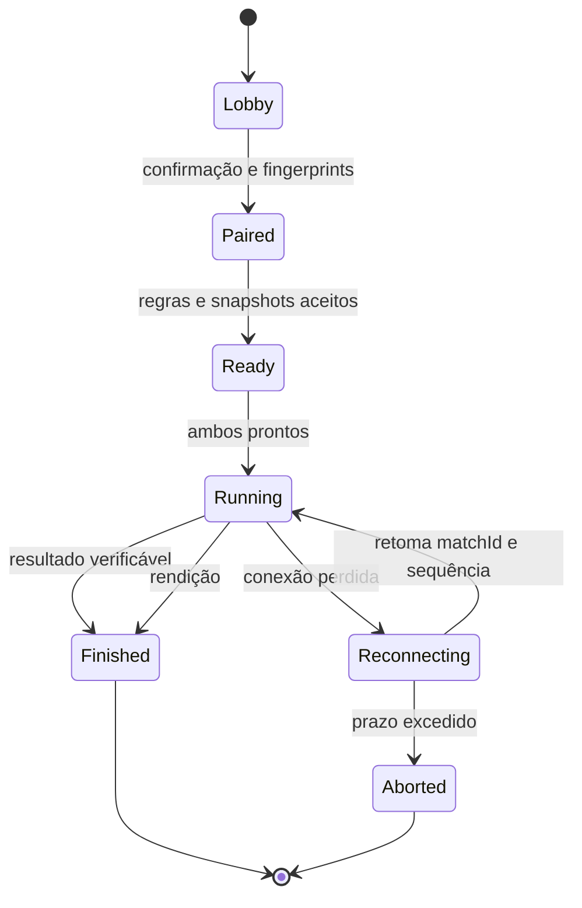

# Plano: perfil de treinador e PvP Pokémon 1×1 na LAN

Status: proposta; nenhuma conta, porta de rede, aposta ou novo serviço foi ativado.
Data: 2026-11-03.
Base: PR [HeitorM50/omapkdex#3](https://github.com/HeitorM50/omapkdex/pull/3), com os pacotes e RNGesus Meter.

## Objetivo e premissas

Criar primeiro um perfil de treinador; depois permitir que dois usuários do
Omarchy escolham um Pokémon capturado e joguem uma partida 1×1, inicialmente
amistosa, na mesma rede local. Apostas usam somente a moeda virtual do plugin,
sem transferir créditos, tokens de API ou dinheiro de provedores de IA.

O repositório já possui `SpeciesProfileView.qml` e `Profile.js`: IVs, natureza,
nível, habilidade, atributos e golpes por indivíduo. Este plano assume que
“perfil” significa treinador, e reaproveita a projeção existente dos Pokémon.
Essa interpretação ainda pode ser ajustada pelo usuário antes da implementação.

Estar no mesmo Wi‑Fi é uma forma prática de encontrar o adversário, mas o
requisito real é conectividade entre os dispositivos. Redes guest, isolamento
de clientes, VLANs e firewall podem impedir descoberta ou conexão. Não tentar
contornar essas políticas nem alterar o firewall automaticamente.

## Entrega 1 — Perfil de treinador e seleção do Pokémon

Adicionar uma tela de treinador com nome, avatar escolhido de recursos locais,
Pokémon selecionado, coleção resumida e histórico de partidas. Usar um ID de
instalação aleatório e estável, sem exigir conta na nuvem. O nome e o avatar
não provam identidade nem propriedade dos Pokémon.

Persistência proposta, separada dos arquivos existentes:

- `trainer.json`: schemaVersion, trainerId, displayName, avatarKey,
  selectedCompanionId e datas; nome limitado a 32 caracteres, texto puro.
- Referenciar **companionId**, não apenas número da espécie: dois indivíduos
  da mesma espécie têm identidades, atributos e histórico distintos.
- Reutilizar Collection.js/Profile.js para a projeção; manter FNV-1a,
  identificadores, IVs, natureza e regras de nível dos indivíduos já capturados.
- Perfil privado por padrão. Não publicar saldo, uso de IA, caminhos de disco,
  lista completa da coleção, nome real ou identificadores de rede.
- A seleção para a barra continua independente da seleção para batalha.
  Exibir essa distinção de forma clara ao escolher o Pokémon.
- Contar vitórias, derrotas e empates a partir de resultados finalizados por
  matchId; uma reconexão não pode contar o mesmo resultado duas vezes.

Aceite: saves antigos abrem sem migração destrutiva; ID persiste após reinício;
escolha entre dois indivíduos da mesma espécie funciona; textos longos e
caracteres de markup são tratados como texto; UI acessível por teclado; mudar
avatar ou seleção não altera crescimento, carteira, Pokédex ou histórico.

## Entrega 2 — Motor local de batalha e amistoso 1×1

Antes de rede, criar um contrato de batalha que funciona offline. Cada jogador
escolhe exatamente um Pokémon já capturado. Congelar o indivíduo e seus dados
no início da partida: espécie alcançada, nível, natureza, habilidade, IVs,
atributos e até quatro golpes. Itens como Mint e Rare Candy e a evolução
continuam funcionando fora da partida; não podem alterar o snapshot em jogo.
Nenhum Pokémon é liberado, perdido ou permanentemente ferido por uma batalha.

Regras iniciais propostas:

- Regras Gen 5/B2W2 para corresponder ao conjunto atual de espécies e golpes;
  não habilitar Mega, Dynamax, itens segurados ou equipes de múltiplos Pokémon.
- Dois formatos amistosos: nível real e nível normalizado em 50. O convite
  mostra o formato e ambos aceitam o mesmo ruleset antes de começar.
- Escolhas de golpe simultâneas por turno; resolver prioridade, velocidade,
  dano, acurácia, PP, status, imunidades, efeitos e empates de forma determinística.
- Vitória por desmaio do adversário ou rendição explícita; regras de empate,
  ausência de golpes/Struggle e limite de turnos fazem parte do ruleset.
- A partida começa com recursos temporários próprios (HP/PP/status); nada é
  salvo de volta como dano ao Pokémon da coleção.

Fazer um spike para avaliar o simulador do Pokémon Showdown, que fornece API
Node e API de linha de comando. Isso evita reimplementar centenas de efeitos,
mas adiciona Node a um plugin cujo runtime atual usa Python stdlib e QML.
Comparar instalação, versão fixada, validação de equipes, replay determinístico,
tempo de início, memória, integração e suporte a Gen 5 antes de adotar.
Preservar avisos MIT do software; essa licença não cobre arte Pokémon.

O spike deve usar apenas APIs documentadas e uma versão fixada. Não instalar
bibliotecas nem executar scripts de dependências como parte deste planejamento.
Se o custo de empacotamento for inadequado, propor explicitamente um ruleset
reduzido; não anunciar compatibilidade com as regras completas sem implementá-las.

Aceite: fixtures de batalha reproduzíveis; cobertura para eficácia, prioridade,
status, Struggle, imunidades, rendição e empate; snapshot imutável; replay
recalcula o vencedor; trabalho de simulação fora da thread do Quickshell.

## Entrega 3 — Conexão e amistosos na rede local

Processo auxiliar de rede separado do QML e do sincronizador de uso. O shell
renderiza a sala e a partida; o serviço trata sockets e o motor trata turnos.
Só iniciar escuta e descoberta ao clicar em “Jogar na LAN”; fechar a sala
encerra anúncios e sockets que não estejam em partida.

Proposta de conexão:

1. Criar sala em uma interface local escolhida; anunciar serviço
   `_omapkdex._tcp.local` via mDNS/DNS-SD, com ID efêmero de sala e versão de protocolo.
2. Listar salas descobertas. Se multicast estiver bloqueado, permitir endereço
   e porta informados manualmente, sem varrer a rede.
3. Parear explicitamente: TLS com certificados/chaves de instalação e pinagem
   de fingerprints após confirmação pelos dois usuários. Descoberta não é autenticação.
4. Após pareamento, trocar somente nome de exibição, avatar permitido e o
   snapshot necessário do Pokémon. Ambos confirmam adversário, regras e modo.
5. Trancar snapshots e iniciar a máquina de estados da partida.

O uso de mDNS/DNS-SD segue RFCs 6762/6763; a biblioteca concreta de descoberta
será escolhida no spike. Python asyncio fornece streams TCP com suporte a SSL
como opção de transporte, sem exigir um servidor web no plugin.

Mensagens com versão, matchId, sequence e type, em frames de tamanho limitado
(proposta: 64 KiB), com enum de ações e limites para nome, convite e timeout.
Não aceitar caminhos, URLs de avatar/sprite, comandos de shell ou objetos de
save enviados pelo adversário. Rejeitar mensagens repetidas, turnos fora de
ordem, IDs desconhecidos, payloads grandes e incompatibilidade de ruleset.

Máquina de estados proposta:

Um peer hospeda a sala e coordena mensagens; ambos conseguem reproduzir o
motor e comparar hashes do estado. Definir protocolo de commit/reveal de
escolhas e sementes para reduzir vantagens de observar o comando adversário.
Não apresentar isso como proteção completa contra um host ou cliente malicioso:
abortos seletivos e saves adulterados continuam possíveis em um sistema local.

Aceite: dois dispositivos reais na mesma LAN; conexão manual sem multicast;
IPv4 e IPv6 conforme suportados pelo spike; rejeição de peer não pareado;
reconexão sem turno duplicado; queda do host não altera saldo; logs sem uso de
IA ou dados privados; cancelamento e erro de firewall compreensíveis na UI.

## Entrega 4 — Batalhas valendo tokens

Decisão de confiança necessária antes de implementar. Hoje lifetimeTokens e
spentTokens vêm de arquivos sob controle de cada usuário. TLS protege o
transporte; assinaturas e replay não provam que o saldo é honesto e não impedem
restaurar um backup local. Dois arquivos em máquinas diferentes também não
oferecem uma transação atômica entre si.

Duas opções a avaliar, sem omitir a limitação:

| Opção | Benefício | Limite |
| --- | --- | --- |
| Aposta LAN entre amigos | Continua local, sem contas ou infraestrutura externa | Confiança explícita; cliente pode adulterar saldo, reverter save ou não honrar resultado |
| Autoridade neutra para carteira e arbitragem | Reserva e liquidação verificáveis em um ledger único | Exige serviço escolhido pelos jogadores; saldos de origem local ainda precisam de política de admissão/validação |

Amistoso deve ser o padrão e sempre funcionar sem apostas. Não afirmar que uma
aposta descentralizada é segura contra trapaça. A implementação do modo com
aposta deve declarar qual das duas opções suporta; propor a segunda para uma
modalidade competitiva com saldo confiável.

Contrato econômico a definir e testar:

- Ambos aceitam explicitamente o mesmo valor inteiro e o mesmo ruleset.
  Conferir saldo disponível incluindo reservas; impedir dois jogos apostarem
  simultaneamente os mesmos tokens ou gastar a reserva na loja.
- Registrar escrow por matchId; nenhum comando de rede escreve state.json
  diretamente. Toda mutação local da carteira usa a mesma autoridade/escritor
  e lock das compras, com um registro idempotente do resultado.
- Nunca somar prêmio em lifetimeTokens: isso causaria crescimento gratuito.
  Acrescentar um ledger ou saldo de resultados separado da progressão de IA.
- Modelo contábil proposto: disponível = lifetimeTokens − spentTokens
  + battleNet − reservedStakes. battleNet pode ser positivo ou negativo.
  Ao apostar S, reservar S; ao vencer, liberar sua reserva e somar S ao net;
  ao perder, liberar reserva e subtrair S; empate/abortamento válido libera a
  reserva sem ganho. Sem taxa, soma dos dois saldos deve ser conservada.
- Validar liquidação apenas uma vez, inclusive após replay, crash e reconexão.
  Não aumentar spentTokens e também subtrair battleNet para a mesma derrota.
- Partições de rede não autorizam reembolso unilateral e posterior prêmio.
  Enquanto não houver resultado final aceito pela autoridade escolhida, manter
  estado pendente e uma política de resolução explícita.
- Informar valor, perda máxima e política de desconexão antes da confirmação.
  Definir limites configuráveis por partida e histórico legível das transações.

Aceite: teste de conservação de tokens, dupla liquidação, saldo insuficiente,
concorrência com a loja, restauração/reexecução, timeout durante reserva,
resultado divergente e reconexão após confirmação parcial. Testar com processos
isolados e depois dois dispositivos, sem usar a carteira real do usuário.

## Sequência de PRs e dependências

| Ordem | Entrega | Prova de conclusão |
| --- | --- | --- |
| 1 | Perfil de treinador e seleção por indivíduo | Saves antigos preservados, UI e testes de identidade/seleção |
| 2 | Spike do simulador e ADR de ruleset | Comparativo de dependências, licença, fixtures e replay |
| 3 | Motor offline e interface da batalha | Dois jogadores locais, resultado reproduzível, sem alteração da coleção |
| 4 | Pareamento e amistoso LAN | Dois dispositivos, reconexão e falhas de rede verificadas |
| 5 | ADR de autoridade e economia | Escolha explícita entre confiança local e árbitro; protocolo e ledger definidos |
| 6 | Apostas e liquidação | Invariantes econômicas, idempotência e resolução de falhas testadas |

Os PRs 1–4 não dependem de uma decisão sobre apostas. A implementação seguinte
pode começar pelo perfil após confirmar essa interpretação; estimativas de prazo
ficam para depois do spike do motor e da decisão de confiança.

## Fontes primárias consultadas

- [RFC 6762 — Multicast DNS](https://www.rfc-editor.org/rfc/rfc6762)
- [RFC 6763 — DNS-Based Service Discovery](https://www.rfc-editor.org/rfc/rfc6763)
- [Python asyncio streams e suporte a SSL](https://docs.python.org/3/library/asyncio-stream.html)
- [Pokémon Showdown: API do simulador](https://github.com/smogon/pokemon-showdown/blob/master/sim/README.md)
- [Licença MIT do Pokémon Showdown](https://github.com/smogon/pokemon-showdown/blob/master/LICENSE)

As escolhas de transporte, bibliotecas, regras e autoridade acima são propostas
arquiteturais; as fontes documentam os mecanismos disponíveis, não validam um
protocolo ou uma implementação que ainda não foram construídos.
